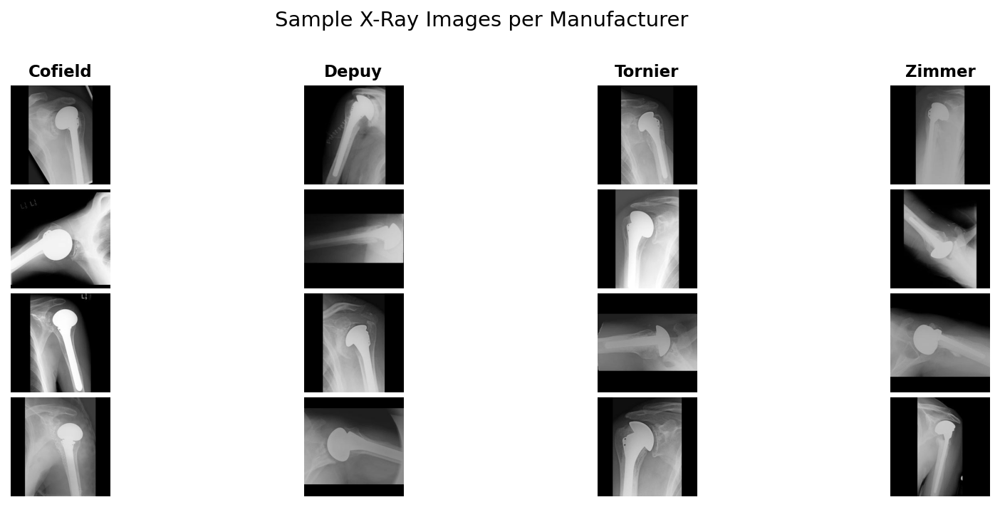
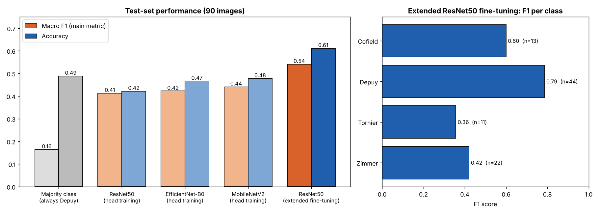
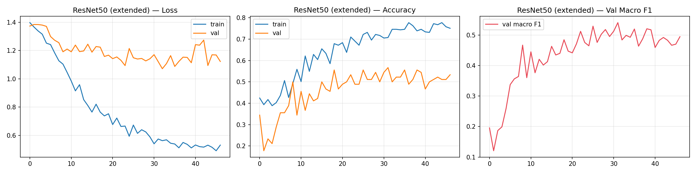

# Shoulder Implant Manufacturer Classification from X-rays

[](https://opensource.org/licenses/MIT)
[](https://www.python.org/)
[](https://pytorch.org/)
[](https://scikit-learn.org/)
[](#results)

Identifying the manufacturer of a shoulder implant (**Cofield, Depuy, Tornier or Zimmer**) from a single X-ray image using transfer learning with convolutional neural networks.

When a patient needs revision surgery, the surgeon must know which implant is already in place, and records are often missing. Automatic identification from an X-ray could save time and reduce risk.

📄 **Full write-up: [Project report](report/project_report.md)** (method, per-class results, discussion and limitations).



---

## Results

The best recorded model, from the **extended ResNet50 fine-tuning** experiment, reached **61.1% accuracy and a macro F1 of 0.541** on a held-out test set of 90 images.

| Model | Accuracy | Macro F1 | Weighted F1 |
| :--- | ---: | ---: | ---: |
| Majority class (always "Depuy") | 0.489 | 0.164 | n/a |
| ResNet50, head training | 0.422 | 0.413 | 0.436 |
| EfficientNet-B0, head training | 0.467 | 0.423 | 0.464 |
| MobileNetV2, head training | 0.478 | 0.441 | 0.488 |
| **ResNet50, extended fine-tuning** | **0.611** | **0.541** | **0.617** |

Sources: [`results/baseline_comparison.csv`](results/baseline_comparison.csv) and [`models/resnet50_extended_results.json`](models/resnet50_extended_results.json). The majority-class row is calculated from the test-set class counts.



**Key findings**

- **The extended ResNet50 fine-tuning configuration achieved higher macro F1** than the head-training baselines (0.541 vs 0.413 for head-trained ResNet50). Several settings changed together (unfrozen `layer4`, head design, augmentation, learning rates and training length), so the gain cannot be attributed to any single change.
- **Macro F1 is the main metric.** Depuy makes up about half the data, so always predicting Depuy scores 48.9% accuracy but only 0.164 macro F1.
- **The smallest class scored lowest.** Depuy (F1 0.786) and Cofield (0.600) scored highest. Tornier (0.357, 11 test images) scored lowest; class imbalance is a plausible cause but has not been tested.



---

## Experiments

Each CNN training experiment (steps 3, 5, 5b, 8 and 9) starts from **fresh ImageNet weights** and does not resume an earlier checkpoint. The HOG baseline (step 7) does not use ImageNet weights, and the TTA and ensemble step (step 10) loads checkpoints saved by earlier steps instead of training.

| Experiment | Script | What it does | Test results included |
| :--- | :--- | :--- | :---: |
| Head training (baselines) | `step3`, `step4` | MobileNetV2, ResNet50, EfficientNet-B0 with frozen backbones and a new classification head | Yes |
| Standard fine-tuning | `step5`, `step6` | All three backbones with their final feature blocks unfrozen, up to 60 epochs, early stopping (patience 8) | No |
| **Extended ResNet50 fine-tuning** | `step5b` | ResNet50 with `layer4` unfrozen, up to 80 epochs, early stopping (patience 15) | **Yes (best model)** |
| HOG classical baseline | `step7` | HOG features with SVM and Random Forest | No |
| 5-fold cross-validation | `step8` | Stratified cross-validation of ResNet50 | No |
| Oversampling | `step9` | ResNet50 with minority-class oversampling instead of class weights | No |
| TTA and ensemble | `step10` | Test-time augmentation and soft-vote ensembling | No |

"No" means the code is implemented but its results are not included in this repository yet.

**Shared method**

1. **Data:** 597 X-rays, imbalanced (Depuy 294, Zimmer 149, Cofield 83, Tornier 71).
2. **Pre-processing:** grayscale → resize to 224×224 → scale to [0, 1] → 3 channels with ImageNet normalisation. Stratified 70/15/15 split (417/90/90) with random state 42.
3. **Class imbalance:** class-weighted cross-entropy loss. Validation macro F1 selects checkpoints and triggers early stopping.
4. **Extended fine-tuning settings:** learning rate 5e-5 for `layer4` and 5e-4 for the head, dropout, augmentation (flips, ±20° rotation, translation and scaling, brightness and contrast), ReduceLROnPlateau scheduling.

---

## Project structure

```text
shoulder-implant-classification/
├── README.md
├── LICENSE                          # MIT
├── requirements.txt
├── src/                             # Pipeline scripts, run from any directory
│   ├── step1_load_dataset.py        # Load images, EDA plots (importable module)
│   ├── step2_preprocess.py          # Split, normalise, class weights
│   ├── step3_train_model.py         # Head-training baselines
│   ├── step4_evaluate_model.py      # Evaluate baselines on the test set
│   ├── step5_improve_model.py       # Standard fine-tuning (3 backbones)
│   ├── step5b_resnet50_extended.py  # Extended ResNet50 fine-tuning (best model)
│   ├── step6_evaluate_improved.py   # Evaluate standard fine-tuned models
│   ├── step7_traditional_baseline.py
│   ├── step8_cross_validation.py
│   ├── step9_oversample_resnet50.py
│   └── step10_ensemble_tta.py
├── images/                          # Charts and confusion matrices
├── results/                         # Classification reports and comparison CSV
├── models/                          # Training summaries (.json); weights are not stored in git
└── report/
    └── project_report.md
```

---

## Getting started

```bash
git clone https://github.com/asmeromberhane/shoulder-implant-classification.git
cd shoulder-implant-classification
python3 -m venv .venv && source .venv/bin/activate   # Windows: .venv\Scripts\activate
pip install -r requirements.txt
```

Download the dataset from the [UCI Machine Learning Repository](https://doi.org/10.24432/C5F893) and put the 597 `.jpg` files directly in a `dataset/` folder at the project root. Then run:

```bash
python src/step1_load_dataset.py
python src/step2_preprocess.py          # creates splits/
python src/step3_train_model.py
python src/step4_evaluate_model.py
python src/step5b_resnet50_extended.py  # extended ResNet50 fine-tuning
```

This sequence reproduces the headline result. The additional experiments have their own prerequisites:

| Step | Needs first |
| :--- | :--- |
| `step5_improve_model.py` (standard fine-tuning) | `splits/` from step 2 |
| `step6_evaluate_improved.py` | Standard fine-tuned checkpoints from **step 5**; also reads `results/baseline_comparison.csv` from step 4 if present |
| `step7_traditional_baseline.py` | `splits/` from step 2 |
| `step8_cross_validation.py` | Only the raw `dataset/` folder |
| `step9_oversample_resnet50.py` | `splits/` from step 2 |
| `step10_ensemble_tta.py` | Standard fine-tuned checkpoints from **step 5**; uses the step 5b checkpoint for ResNet50 if it exists; reads `results/finetuned_comparison.csv` from step 6 if present |

The scripts use Apple Silicon (MPS) when available, otherwise CPU. Pretrained ImageNet weights download on first use. Rerunning a script overwrites its charts and result files.

---

## Limitations

- **Small test set:** 90 images (11 Tornier), so the scores are uncertain. Confidence intervals have not yet been calculated.
- **Results not yet included** for standard fine-tuning, the HOG baseline, cross-validation, oversampling and the ensemble.
- **No patient-level information,** so images from the same patient could appear in more than one split.
- This is a research and learning project, not a clinically validated tool.

## Roadmap

- [ ] Set PyTorch, NumPy and Python random seeds in every training script.
- [ ] Wrap steps 2–10 in `main()` functions so they can be imported without running (`step1` is already import-safe).
- [ ] Decide on BatchNorm handling for frozen layers: head training calls `model.train()`, so frozen BatchNorm layers still update their running statistics.
- [ ] Add CUDA device selection.
- [ ] Run and report steps 6–10, with bootstrap confidence intervals for the test metrics.
- [ ] Make the HOG comparison fair: step 7 fits its classifiers on training **plus validation** images, while the CNNs train on the training subset only. Disclose or align this before comparing the two.
- [ ] Make the TTA comparison like-for-like: step 10 uses the extended ResNet50 checkpoint when it exists, but compares against standard fine-tuned ResNet50 results from step 6. Use matching checkpoints, or state the difference, before reporting TTA gains.
- [ ] Add Grad-CAM visualisations to show which image regions drive predictions.

---

## Dataset and credits

*Shoulder Implant X-Ray Manufacturer Classification* (2020), UCI Machine Learning Repository, https://doi.org/10.24432/C5F893, licensed under [CC BY 4.0](https://creativecommons.org/licenses/by/4.0/). Images are de-identified and were collected from the University of Washington Shoulder Site, manufacturer websites and the Feeley Lab at UCSF. `images/sample_images.png` shows dataset images; keep this attribution when sharing them.

## Author

**Asmerom Berhane**: [LinkedIn](https://www.linkedin.com/in/asmerom-berhane-36a130122) · [GitHub](https://github.com/asmeromberhane)

Code released under the [MIT License](LICENSE).
